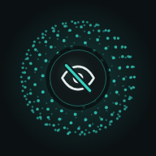

# PrivateMuch
Vibecoded (but works and is cool) app for searching privately. The app is vibecoded and not the search engine and other stuff outside the app.

A private search page with a springy 3D dot globe. Search with DuckDuckGo or chat with Duck.ai, and nothing you type is kept.

## Get it

- **Android app:** [download PrivateMuch.apk](https://github.com/NucleanYT/PrivateMuch/releases/download/latest/PrivateMuch.apk) and open it on your phone to install. Android will ask you to allow installs from your browser or file manager the first time.
- **Web version:** [nucleanyt.github.io/PrivateMuch](https://nucleanyt.github.io/PrivateMuch/). Open it in a private (incognito) tab for the most privacy.

## What it does

- **Dot globe:** a rotating 3D globe of dots behind an eye icon. Drag it to spin it; the globe leans toward your finger while the dots spring away from it. Tap it to make it bounce.
- **Search or AI:** a switch above the search bar picks where your text goes. With DuckDuckGo (the default), Search opens DuckDuckGo results and Duck.ai sends it to Duck.ai through DuckDuckGo's `!ai` shortcut. With Brave, Search opens Brave Search and Ask Brave sends it to Brave's AI search.
- **Settings (app):** the gear on the home page switches between DuckDuckGo + Duck.ai and Brave Search + Ask Brave. The app remembers it, along with your bookmarks; nothing else. In a browser, add `?engine=brave` to the web version's link.
- **Web addresses:** type an address like `example.com` or `https://example.com` and the site opens directly, like a browser's address bar. In the app this works in DuckDuckGo's own search box too.
- **Blocks adult content:** searches and Duck.ai questions with adult words are blocked, including disguised spellings like "p0rn" or "p o r n". Every DuckDuckGo search uses strict Safe Search.
- **Private browsing explained:** a 3D card that tilts where you press it, showing what gets deleted, who can still see your activity, and a live count of the cookies and storage on your device for the site it's running on.

## Privacy

The page sets no cookies, stores nothing on your device, loads nothing from other sites and has no trackers. The search box clears itself after every search.

The Android app goes further:

- Search results and chats open inside the app, so they never reach your browser's history.
- While a site is open, the top bar is an address bar: tap it to type a web address or a search. It has a lock for secure sites, reload, a loading line and a Home button. The keyboard isn't allowed to learn what you type there.
- A bottom bar with Back, Forward, Bookmarks, Tabs and New tab shows while a site is open, and steps aside while you type in the address bar.
- Bookmarks (bottom bar, or the home page next to Tabs): save the open page, then open or delete saved ones. They're kept only inside the app on your phone and never backed up or sent anywhere. Along with the search engine choice, they're the only things the app keeps after it closes.
- Private tabs: the tabs button (in the bottom bar, and on the home page next to Settings) shows how many are open and opens a history-free overview of tab cards with previews, where you can switch, close one or all tabs, or open a new one. Tabs live only in memory and are wiped with everything else when the app closes.
- Cookies, site data, cache and history are wiped every time the app starts and closes.
- Your keyboard is told not to learn what you type, autofill is off, and the app is never backed up.
- Adult websites are blocked inside the app, and so are adult searches typed into DuckDuckGo's own search box. Strict Safe Search is forced on for every DuckDuckGo and Brave search.

The adult filter is a word list, so it can't catch everything. It can't read what you type inside the Duck.ai chat after it opens, and in the web version it only checks the PrivateMuch search box. The lists live in `index.html` and in `ContentFilter.java` and `UrlInput.java`, and the build fails if they ever differ.

What it can't hide: the websites you visit, DuckDuckGo and Duck.ai themselves, your Wi-Fi, school or work network, and your internet provider can still see your activity.

## Updating the app

Tap **Update** in the top-right corner of the app's home page. It checks GitHub for a newer build, downloads it and opens Android's installer. It only checks when you tap it. The first time, Android asks you to let PrivateMuch install apps.

## How it's made

| Path | What it is |
| --- | --- |
| `index.html` | The whole page: layout, globe, search and card, in one file with no outside libraries |
| `manifest.webmanifest`, `icons/` | App name and icons for adding the web version to a home screen |
| `android/` | The Android app, which shows `index.html` in a private built-in browser |
| `.github/workflows/android.yml` | Builds the APK on every push and publishes it as the `latest` release |
| `MEMORY_NOTES.md` | Notes on preferences and past fixes, so future changes keep what works |

To build the app yourself, install JDK 17 and the Android SDK, then run `./gradlew assembleRelease` inside `android/`. The APK ends up in `android/app/build/outputs/apk/release/`.

## License

GPL-2.0. See [LICENSE](LICENSE).
